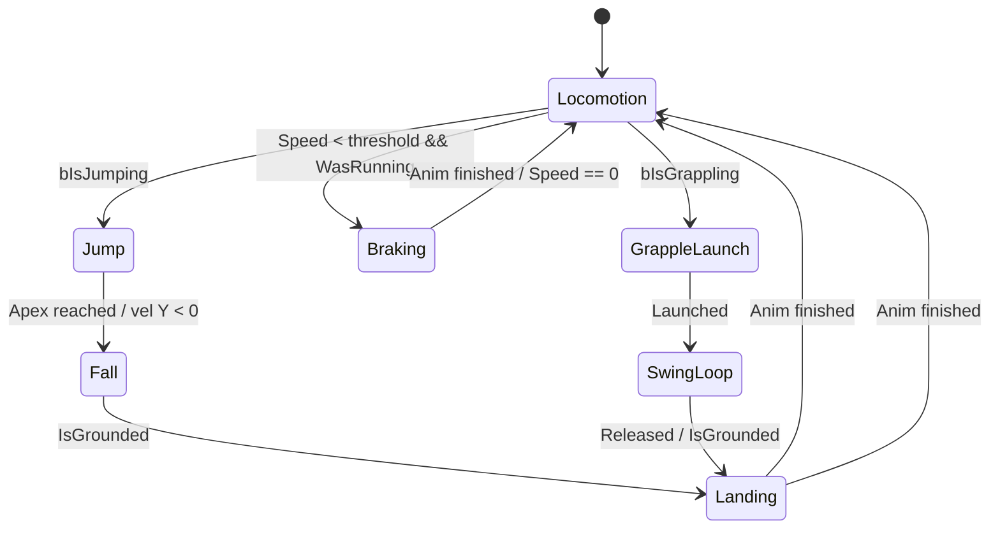

# 🎮 Guía: Animation State Machine en Unreal Engine 5.8
### Proyecto Rumi — Personaje Student + Rumi

> [!IMPORTANT]
> Esta guía asume que ya tienes funcionando: **Idle**, **Walk**, **Run**, **Jump** en tu State Machine.
> El objetivo es completar: **Braking (frenado)**, **Landing (aterrizaje)**, y la secuencia de **Swing/Grapple** (balanceo tipo látigo).

---

## 🗺️ Mapa de estados — tu objetivo final



> [!NOTE]
> **Landing se reutiliza** para el aterrizaje normal y el del grapple — exactamente lo que querías. Un solo estado, dos transiciones de entrada distintas.

---

## 📚 Glosario rápido — conceptos clave

| Término UE | Qué es | Dónde vive |
|---|---|---|
| **AnimBlueprint (ABP)** | El cerebro de las animaciones. Contiene la lógica (EventGraph) y la máquina de estados (AnimGraph) | `Content/Characters/Student/Student_Skeleton_AnimBlueprint` |
| **AnimGraph** | El panel visual donde conectas nodos; la salida es la pose final del esqueleto | Tab "AnimGraph" en el ABP |
| **State Machine** | Nodo dentro del AnimGraph que gestiona estados y transiciones | Nodo dentro del AnimGraph |
| **Estado (State)** | Un nodo que reproduce una animación (o blend). Doble clic para entrar | Dentro de la State Machine |
| **Transición (Transition)** | La flecha entre dos estados. Define *cuándo* cambiar. Tiene su propia regla (Rule) | La flecha entre estados |
| **BlendSpace (BS)** | Asset que mezcla animaciones según ejes (Speed, Direction). Tu `Student_Skeleton_BlendSpace` es para locomotion | `Content/Characters/Student/Animations/` |
| **EventGraph** | Panel de Blueprint donde calculas variables (Speed, bIsJumping, etc.) que la State Machine lee | Tab "EventGraph" en el ABP |
| **Notify** | Marcas en una animación en el timeline. Útiles para trigger eventos (ej: "toca el suelo en el frame 12") | Dentro del editor de animación |

---

## 🔵 FASE 1 — Verificar tu State Machine actual

**Dónde abrir:**
1. `Content Browser` → `Characters/Student` → doble clic en `Student_Skeleton_AnimBlueprint`
2. Arriba aparecen tabs: **EventGraph** y **AnimGraph** — ve a **AnimGraph**
3. Busca el nodo **State Machine** (probablemente llamado `Locomotion` o `MainStateMachine`) → **doble clic** para entrar

**Qué deberías ver:**
- Un estado **Idle/Walk/Run** (probablemente tu BlendSpace `Student_Skeleton_BlendSpace`)
- Un estado **Jump** (con `Student_Jump`)
- Un estado **Fall** (con `Student_FallLoop`)
- Flechas (transiciones) entre ellos

> [!TIP]
> Si ves todo en un solo estado "Default", está bien — significa que usaste directamente la animación sin separar. Puedes refactorizar.

---

## 🟡 FASE 2 — Agregar variables en el EventGraph

Antes de tocar la State Machine, necesitas que el ABP "sepa" el estado del personaje. Las variables se calculan en el **EventGraph**.

### 2.1 Abrir el EventGraph
- Tab **EventGraph** en el ABP
- Verás un nodo `Event Blueprint Update Animation` — todo empieza desde ahí

### 2.2 Variables que necesitas

Ve al panel **My Blueprint** (izquierda) → sección **Variables** → botón **+**

| Variable | Tipo | Para qué |
|---|---|---|
| `Speed` | Float | Velocidad horizontal del personaje |
| `bIsInAir` | Bool | ¿Está en el aire? |
| `bIsJumping` | Bool | ¿Acaba de saltar (impulso inicial)? |
| `bWasRunning` | Bool | ¿Venía corriendo antes de frenar? |
| `bIsGrappling` | Bool | ¿Está en modo swing/grapple? |
| `bGrappleReleased` | Bool | ¿Acaba de soltar el grapple? |

### 2.3 Calcular Speed y bIsInAir (el patrón estándar)

En el EventGraph, desde `Event Blueprint Update Animation`:

```
Event Blueprint Update Animation
  └─► Try Get Pawn Owner
        └─► [Is Valid?]
              ├── Get Velocity → VectorLength → Speed (SET)
              └── Get Movement Component → Is Falling → bIsInAir (SET)
```

**Paso a paso en la interfaz:**
1. Clic derecho en el EventGraph → busca `Try Get Pawn Owner` → conecta al nodo `Update`
2. Desde `Return Value` del Pawn Owner → arrastra → busca `Get Velocity`
3. Desde `Velocity` → arrastra → busca `VectorLength XY` (o `VectorLength` — VectorLength XY ignora el eje Z, mejor para velocidad horizontal)
4. Desde el resultado Float → arrastra a la variable `Speed` → `SET Speed`
5. Desde `Pawn Owner` → arrastra → busca `Get Movement Component`
6. Desde `Movement Component` → arrastra → busca `Is Falling` → conecta a `SET bIsInAir`

> [!TIP]
> **Usa `Cast to CharacterMovementComponent`** si quieres acceder a más propiedades específicas del personaje. Para empezar, `Is Falling` desde GetMovementComponent basta.

---

## 🟠 FASE 3 — Estado de Braking (Frenado)

### ¿Qué es el Braking?
Cuando el personaje **venía corriendo y frena**, en vez de pasar directo a Idle, reproduce una animación de "deslizamiento/freno". Esto se ve mucho más natural.

### 3.1 ¿Tienes la animación?
- Revisa en `Content/Characters/Student/Animations/` — ¿hay algo como `Student_Braking` o `Student_Stop`?
- Si no tienes una, **puedes descargar de Mixamo**: busca **"Running Stop"** o **"Skid Stop"** y retargetear al skeleton del Student.

> [!NOTE]
> Si el skeleton del Student viene de Mixamo, el retarget es directo: UE5 tiene herramientas de IK Rig + IK Retargeter que mapean automáticamente humanoides.

### 3.2 Agregar el estado Braking en la State Machine

1. **Entra a la State Machine** (doble clic en el nodo State Machine en el AnimGraph)
2. **Clic derecho** en espacio vacío → `Add State` → nómbralo `Braking`
3. **Doble clic en el estado Braking** para abrirlo
4. Arrastra la animación `Student_Braking` desde el Content Browser al estado → conéctala al nodo `Output Animation Pose`

### 3.3 Transiciones del Braking

**Locomotion → Braking** (cuando frena viniendo de correr):
1. Pasa el cursor sobre el estado `Locomotion/BlendSpace` → aparece un círculo en el borde → arrastra hasta `Braking`
2. **Doble clic en la flecha** → abre la **Transition Rule** (regla de transición)
3. Clic derecho → `Add Pin` / busca variables → conecta:
   ```
   Speed < 50.0  AND  bWasRunning == true
   → Result (bool)
   ```

**Braking → Locomotion/Idle** (cuando termina el freno):
1. Arrastra desde `Braking` hacia `Locomotion`
2. En la Transition Rule:
   - Opción A (por tiempo): usa `Time Remaining (ratio) < 0.2` — el estado pasa cuando la anim está al 80%
   - Opción B (por velocidad): `Speed < 5.0` — cuando está prácticamente quieto

> [!TIP]
> **Combina ambas**: `(TimeRemainingRatio < 0.1) OR (Speed < 5)` — así no se queda atascado si la anim es muy larga.

---

## 🔴 FASE 4 — Estado de Landing (Aterrizaje)

### 4.1 Ya tienes `Student_FallLoop` — falta el Landing

El Landing es la animación corta de impacto cuando toca el suelo. Revisa si tienes algo como `Student_Land` o `Student_Landing` en tus animaciones. Si no, descarga de Mixamo: **"Hard Landing"** o **"Soft Landing"**.

### 4.2 Agregar el estado Landing

1. En la State Machine → clic derecho → `Add State` → nómbralo `Landing`
2. Doble clic en `Landing` → arrastra la animación de aterrizaje → conecta al Output

**Importante:** Desactiva el loop en la animación:
- Doble clic en el asset de animación → panel derecho → **Loop Animation = OFF**

### 4.3 Transiciones del Landing

**Fall → Landing:**
```
Transition Rule: bIsInAir == false  (ya tocó el suelo)
```

**Landing → Locomotion:**
```
Transition Rule: Time Remaining (ratio) < 0.15
(cuando la animación de aterrizaje está casi terminando)
```

> [!NOTE]
> Esta es la clave que hace que el Landing **sea reutilizable**: cualquier estado que quiera ir a Landing solo necesita una transición hacia él. El Landing siempre termina volviendo a Locomotion.

---

## 🟣 FASE 5 — La secuencia Grapple / Swing (balanceo tipo látigo)

Esta es la parte más interesante. El flujo completo:

```
[Locomotion] → (Activa grapple) → [GrappleLaunch] → [SwingLoop] → (Suelta) → [Landing] → [Locomotion]
```

### 5.1 Animaciones necesarias

| Animación | Descripción | Mixamo sugerido |
|---|---|---|
| `Student_GrappleLaunch` | El momento de lanzar/aferrarse y salir disparado | "Flying Kick" / "Jump Forward" adaptado |
| `Student_SwingLoop` | Balanceo en el aire — **loop** | "Hanging" / "Swing" / "Brachiation" |
| `Student_GrappleLand` | Aterrizaje tras soltar — **reutilizar Landing existente** | Ya lo tienes |

### 5.2 Crear los estados

1. **GrappleLaunch**: estado con `Student_GrappleLaunch` (sin loop, transición rápida)
2. **SwingLoop**: estado con `Student_SwingLoop` (con loop activado)

### 5.3 Transiciones del Grapple

**Locomotion → GrappleLaunch:**
```
Transition Rule: bIsGrappling == true
```

**GrappleLaunch → SwingLoop:**
```
Transition Rule: Time Remaining (ratio) < 0.1
(cuando termina el launch, entra al loop de balanceo)
```

**SwingLoop → Landing** (reutilizando el estado existente):
```
Transition Rule: bGrappleReleased == true  AND  bIsInAir == false
```
O si suelta en el aire:
```
Transition Rule: bGrappleReleased == true
→ va a Fall (si está en el aire) → cae → Landing
```

> [!TIP]
> Para manejar "suelta en el aire", puedes hacer `SwingLoop → Fall` con `bGrappleReleased == true && bIsInAir == true`, y luego `Fall → Landing` como ya tienes. Así Landing siempre llega por Fall, que es más limpio.

### 5.4 Conectar con el Blueprint del personaje

En el **Blueprint del personaje** (BP_ThirdPersonCharacter o el tuyo), cuando el jugador activa el grapple:
1. `SET bIsGrappling = true`
2. Cuando suelta: `SET bIsGrappling = false`, `SET bGrappleReleased = true`
3. En el EventGraph del ABP, leer estas variables desde el Pawn Owner:
   ```
   Try Get Pawn Owner → Cast to BP_TuPersonaje → GET bIsGrappling → SET bIsGrappling (del ABP)
   ```

---

## ✅ FASE 6 — Checklist y mejores prácticas UE5.8

### Checklist de implementación

- [ ] Variables calculadas en EventGraph (`Speed`, `bIsInAir`, `bIsGrappling`, etc.)
- [ ] Estado `Braking` creado con animación y transiciones
- [ ] Estado `Landing` creado (non-loop), con transición desde `Fall`
- [ ] `Landing → Locomotion` por `TimeRemainingRatio`
- [ ] Estado `GrappleLaunch` (non-loop)
- [ ] Estado `SwingLoop` (loop activado)
- [ ] `SwingLoop → Fall → Landing` cuando suelta en el aire
- [ ] Variables del grapple seteadas desde el Character Blueprint
- [ ] Compilar y guardar el ABP (botón Compile arriba a la izquierda)

### Mejores prácticas modernas UE5.8

| Práctica | Por qué |
|---|---|
| **Calcular todo en EventGraph, no en la Transition Rule** | Las Transition Rules se evalúan cada frame — mantenerlas simples (solo leer variables bool/float) mejora el rendimiento |
| **Usar `Time Remaining (ratio)` para salir de estados non-loop** | Más robusto que timers manuales — se adapta si cambias la duración de la anim |
| **Poner el estado Landing como "hub"** — todas las caídas llegan ahí | Reutilización → menos estados, menos mantenimiento |
| **Nombrar estados con verbo en -ing** | `Braking`, `Landing`, `Swinging` — convención clara de UE |
| **Guardar el ABP después de cada fase** | UE5 puede crashear; salva seguido (Ctrl+S) |
| **Usar "Relevant Anim Notify"** en el Landing para hacer un shake de cámara | Más inmersivo, sin lógica extra en Blueprint |
| **Thread Safe Update Animation** | En UE5.8 el EventGraph puede correr en el hilo de animación; actívalo en Class Settings del ABP para mejor performance |

---

## 🔧 Troubleshooting rápido

| Síntoma | Causa probable | Solución |
|---|---|---|
| El personaje se queda pegado en Landing | Loop Animation está ON en la animación | Abre el asset de anim → desactiva Loop |
| La transición no dispara | La variable no se está actualizando | Verifica el EventGraph — pon un Print String para debug |
| El Braking se activa cuando no debería | `bWasRunning` siempre true | Resetear `bWasRunning` a false cuando Speed < 10 |
| El SwingLoop no hace loop | Loop desactivado en el asset | Abre la animación → activa Loop |
| "Compile Error" en el ABP | Variable mal conectada | Busca el nodo rojo en EventGraph o AnimGraph |

---

## 📁 Assets de tu proyecto relevantes

| Asset | Ruta en el proyecto |
|---|---|
| `Student_Skeleton_AnimBlueprint` | `Content/Characters/Student/` |
| `Student_Skeleton_BlendSpace` | `Content/Characters/Student/Animations/` |
| `Student_Idle` | `Content/Characters/Student/Animations/` |
| `Student_Jump` | `Content/Characters/Student/Animations/` |
| `Student_FallLoop` | `Content/Characters/Student/Animations/` |
| `Student_Running` | `Content/Characters/Student/Animations/` |
| `Student_walking_Anim` | `Content/Characters/Student/Animations/` |
| `ABP_Rumi_Provisional` | `Content/Characters/Rumi/` |
| `BS_Rumi_Provisional_Locomotion` | `Content/Characters/Rumi/Animations/` |

